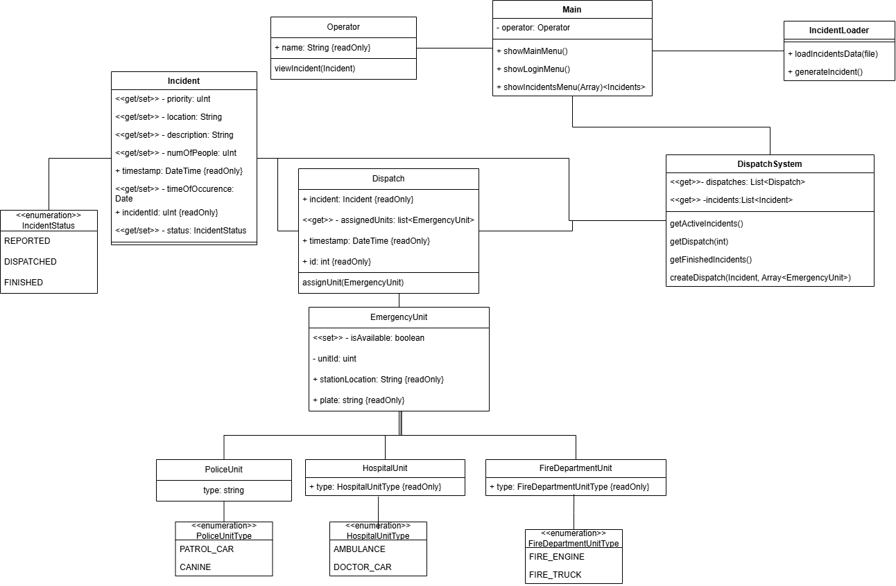

# ResQFlow project

Emergency dispatch centres play an important role in public safety. They receive calls from people who
need help in situations such as medical emergencies, fires, crime, and traffic accidents. Dispatchers
receive emergency calls, assess how serious the situation is, and coordinate emergency services such as
ambulances, police units, and fire departments. A successful emergency response depends on fast and
accurate decision-making. Dispatchers often need to make difficult decisions under pressure and with
limited resources. When several incidents occur, they must decide which situations require the most urgent
attention and how available emergency resources should be used. Delays, poor prioritization, or inefficient
use of resources can affect the quality and speed of the emergency response.

## Problem formulation
To address the critical bottleneck of dispatcher overload, our software simplifies the workspace during high-stress periods—allowing personnel
to quickly manage competing priorities by displaying real-time unit availability, hospital capacities, and customizable emergency triage.
Prioritizing emergency calls under intense mental pressure often leads to delayed response times, contributing to Denmark's estimated 1,200
to 3,000 annual preventable medical deaths. By streamlining decision-making when speed matters most, the software reduces response times to
minimize casualties, mitigate avoidable injuries, and ultimately save lives.

## Software design

